# 架构图

由 `bun tools/architecture.js` 从代码自动生成，勿手改；改了架构重新生成即可。

**图例**：实线 → import；粗线 ⇒ HTTP/SSE 数据流；虚线 ⇢ patch（扩展改写宿主方法）／inject（宿主反向注入）／扩展拓扑（requires/after）／登记。节点内是导出函数清单（超过 8 个显示 +n，本身就提示该文件该拆分）。

## 一、宏观：core → 后端 → 前端 → 扩展

```mermaid
graph TD
    %%{init: {'theme':'neutral','flowchart':{'curve':'basis'}}}%%
    n1n01kdc["<b>@kernel4632/agent-core（npm）</b>"]:::agent-core
    ne4psym["<b>vue（npm）</b>"]:::route
    noesvxz["<b>@hugeicons（npm）</b>"]:::route
    nhqebqq["<b>server</b><br/>create()  wire()"]:::backend
    nbxek49["<b>Agents</b><br/>bind()  all()  open()  peek()  done()  running()  snapshot()  callbacks() +9"]:::backend
    nfkptut["<b>Bundle</b><br/>forget()  pack()"]:::backend
    n1gcjvhk["<b>Extension</b><br/>patch()  restack()  scope()  tool()  track()  op()  push()  expose() +6"]:::backend
    n1r47d4k["<b>Loader</b><br/>BASE()  bind()  roots()  scan()  list()  entries()  inspect()  start() +4"]:::backend
    n6t2ykd["<b>Models</b><br/>list()  resolve()"]:::backend
    n4hgrwm["<b>Store</b><br/>config()  configure()  ensure()  meta()  touch()  history()  append()  write() +2"]:::store
    nytphuv["<b>Stream</b><br/>subscribe()  emit()  feed()  merge()  tail()  retry()  clear()"]:::backend
    naobem8["<b>api</b><br/>connect()"]:::web
    n14sdej9["<b>Agent</b><br/>stop()  configure()  connect()"]:::web
    n1qcy0uz["<b>Extension</b><br/>Components()  dispatch()  register()  load()  run()  unload()  Loaded()  Panels() +3"]:::web
    n2s7pfr["<b>main</b>"]:::web
    n3f77po["<b>App</b>"]:::webui
    nopqhf0["<b>mcp/backend</b>"]:::ext
    n10ycygf["<b>permission/backend</b>"]:::ext
    n6ceey8["<b>session/backend</b>"]:::ext
    n1bwj4wr["<b>settings/backend</b>"]:::ext
    n176bot2["<b>shell/backend</b>"]:::ext
    ndhwbyt["<b>skill/backend</b><br/>scan()"]:::ext
    n1pd8dgu["<b>title/backend</b>"]:::ext
    n19q3pg8["<b>todo/backend</b>"]:::ext
    n1xk5nt7["<b>tools/backend</b>"]:::ext
    nbxek49 --> n1n01kdc
    nbxek49 --> n4hgrwm
    nbxek49 --> n6t2ykd
    nbxek49 --> nytphuv
    n1r47d4k --> n1gcjvhk
    n1r47d4k --> nfkptut
    n1r47d4k --> n4hgrwm
    nhqebqq --> nbxek49
    nhqebqq --> nytphuv
    nhqebqq --> n4hgrwm
    nhqebqq --> n6t2ykd
    nhqebqq --> n1gcjvhk
    nhqebqq --> n1r47d4k
    n14sdej9 --> ne4psym
    n14sdej9 --> naobem8
    n3f77po --> ne4psym
    n3f77po --> n14sdej9
    n3f77po --> n1qcy0uz
    n1qcy0uz --> ne4psym
    n1qcy0uz --> naobem8
    n2s7pfr --> ne4psym
    n2s7pfr --> n3f77po
    n2s7pfr --> n14sdej9
    n2s7pfr --> naobem8
    n2s7pfr --> n1qcy0uz
    n10ycygf -.-> |patch Agents| nbxek49
    ndhwbyt -.-> |patch Agents| nbxek49
    n1pd8dgu -.-> |patch Agents| nbxek49
    n19q3pg8 -.-> |patch Agents| nbxek49
    ndhwbyt -.-> |登记工具| nbxek49
    n19q3pg8 -.-> |登记工具| nbxek49
    n1xk5nt7 -.-> |登记工具| nbxek49
    n1pd8dgu -.-> n6ceey8
    nhqebqq -.-> |注入 tools()| n1gcjvhk
    nhqebqq -.-> |注入 targets| n1r47d4k
    nhqebqq ==> nbxek49
    nhqebqq ==> nytphuv
    nhqebqq ==> n1gcjvhk
    naobem8 ==> |REST + SSE| nhqebqq
    nopqhf0 -.-> |requires| n176bot2
    nopqhf0 -.-> |after| n1bwj4wr
    n10ycygf -.-> |requires| n176bot2
    n10ycygf -.-> |after| n1bwj4wr
    n6ceey8 -.-> |requires| n176bot2
    n1bwj4wr -.-> |requires| n176bot2
    ndhwbyt -.-> |requires| n176bot2
    ndhwbyt -.-> |after| n1bwj4wr
    n1pd8dgu -.-> |after| n6ceey8
    n19q3pg8 -.-> |requires| n176bot2
    n19q3pg8 -.-> |after| n1bwj4wr
    n1xk5nt7 -.-> |after| n1bwj4wr
    classDef agent-core fill:#eef1f5,stroke:#9aa7b8,color:#5a6572
    classDef backend fill:#e8f0fe,stroke:#7a9bd4,color:#2c4a7c
    classDef store fill:#d8e7fa,stroke:#5a86c4,color:#1d3c6e
    classDef web fill:#e9f7ee,stroke:#7cbf95,color:#2c5c3d
    classDef webui fill:#f2fbf5,stroke:#a5d4b8,color:#2c5c3d
    classDef ext fill:#f4edfb,stroke:#a98bc4,color:#5b3d80
    classDef route fill:#fff3e0,stroke:#e0a458,color:#8a5a1a
```

## 二、backend features

```mermaid
graph TD
    %%{init: {'theme':'neutral','flowchart':{'curve':'basis'}}}%%
    nbxek49["<b>Agents</b><br/>bind()  all()  open()  peek()  done()  running()  snapshot()  callbacks() +9"]:::backend
    nfkptut["<b>Bundle</b><br/>forget()  pack()"]:::backend
    n1gcjvhk["<b>Extension</b><br/>patch()  restack()  scope()  tool()  track()  op()  push()  expose() +6"]:::backend
    n1r47d4k["<b>Loader</b><br/>BASE()  bind()  roots()  scan()  list()  entries()  inspect()  start() +4"]:::backend
    n6t2ykd["<b>Models</b><br/>list()  resolve()"]:::backend
    n4hgrwm["<b>Store</b><br/>config()  configure()  ensure()  meta()  touch()  history()  append()  write() +2"]:::store
    nytphuv["<b>Stream</b><br/>subscribe()  emit()  feed()  merge()  tail()  retry()  clear()"]:::backend
    nhqebqq["<b>server</b><br/>create()  wire()"]:::backend
    n1n01kdc["<b>@kernel4632/agent-core（npm）</b>"]:::agent-core
    nbxek49 --> n1n01kdc
    nbxek49 --> n4hgrwm
    nbxek49 --> n6t2ykd
    nbxek49 --> nytphuv
    n1r47d4k --> n1gcjvhk
    n1r47d4k --> nfkptut
    n1r47d4k --> n4hgrwm
    nhqebqq --> nbxek49
    nhqebqq --> nytphuv
    nhqebqq --> n4hgrwm
    nhqebqq --> n6t2ykd
    nhqebqq --> n1gcjvhk
    nhqebqq --> n1r47d4k
    nhqebqq -.-> |注入 tools()| n1gcjvhk
    nhqebqq -.-> |注入 targets| n1r47d4k
    nhqebqq ==> nbxek49
    nhqebqq ==> nytphuv
    nhqebqq ==> n1gcjvhk
    classDef agent-core fill:#eef1f5,stroke:#9aa7b8,color:#5a6572
    classDef backend fill:#e8f0fe,stroke:#7a9bd4,color:#2c4a7c
    classDef store fill:#d8e7fa,stroke:#5a86c4,color:#1d3c6e
    classDef web fill:#e9f7ee,stroke:#7cbf95,color:#2c5c3d
    classDef webui fill:#f2fbf5,stroke:#a5d4b8,color:#2c5c3d
    classDef ext fill:#f4edfb,stroke:#a98bc4,color:#5b3d80
    classDef route fill:#fff3e0,stroke:#e0a458,color:#8a5a1a
```

## 三、web

```mermaid
graph TD
    %%{init: {'theme':'neutral','flowchart':{'curve':'basis'}}}%%
    n14sdej9["<b>Agent</b><br/>stop()  configure()  connect()"]:::web
    naobem8["<b>api</b><br/>connect()"]:::web
    n3f77po["<b>App</b>"]:::webui
    nmdvte5["<b>AssistantMessage</b>"]:::webui
    n1x4hqj0["<b>CodeBlock</b>"]:::webui
    n1eedbfs["<b>CompactMessage</b>"]:::webui
    n1fukcf8["<b>Composer</b>"]:::webui
    n1p9n7s3["<b>ErrorMessage</b>"]:::webui
    n18bqnpc["<b>History</b><br/>History()"]:::webui
    n1v8qy0t["<b>Icon</b>"]:::webui
    n15uqdp7["<b>Process</b>"]:::webui
    n1txskb1["<b>RequestStatus</b>"]:::webui
    ne2t5vv["<b>Stats</b>"]:::webui
    n13y2e7o["<b>Thinking</b>"]:::webui
    nlm1wpm["<b>ToolCall</b>"]:::webui
    nfh54tk["<b>UserMessage</b>"]:::webui
    nep9kbh["<b>demo</b>"]:::web
    net13y9["<b>dev-extensions.prod</b><br/>loadDevExtensions()"]:::web
    nx39sr8["<b>dev-extensions</b><br/>loadDevExtensions()"]:::web
    n1qcy0uz["<b>Extension</b><br/>Components()  dispatch()  register()  load()  run()  unload()  Loaded()  Panels() +3"]:::web
    n7xbudi["<b>history</b><br/>group()"]:::web
    n2s7pfr["<b>main</b>"]:::web
    n492da9["<b>types</b>"]:::web
    n14sdej9 --> naobem8
    n3f77po --> n14sdej9
    n3f77po --> n1qcy0uz
    nmdvte5 --> n1qcy0uz
    n1x4hqj0 --> n1v8qy0t
    n1eedbfs --> n1v8qy0t
    n1fukcf8 --> n14sdej9
    n1fukcf8 --> n1v8qy0t
    n1fukcf8 --> n1qcy0uz
    n1p9n7s3 --> n1v8qy0t
    n1p9n7s3 --> n14sdej9
    n18bqnpc --> n7xbudi
    n18bqnpc --> n14sdej9
    n18bqnpc --> n1qcy0uz
    n15uqdp7 --> n1v8qy0t
    n15uqdp7 --> n1qcy0uz
    n1txskb1 --> n1v8qy0t
    ne2t5vv --> n1v8qy0t
    ne2t5vv --> n14sdej9
    n13y2e7o --> n1v8qy0t
    nlm1wpm --> n1v8qy0t
    nlm1wpm --> n1qcy0uz
    nfh54tk --> n1v8qy0t
    nfh54tk --> n14sdej9
    nep9kbh --> naobem8
    nep9kbh --> n1qcy0uz
    nx39sr8 --> n1qcy0uz
    n1qcy0uz --> naobem8
    n2s7pfr --> n3f77po
    n2s7pfr --> n14sdej9
    n2s7pfr --> naobem8
    n2s7pfr --> n1qcy0uz
    n2s7pfr --> nx39sr8
    n2s7pfr --> net13y9
    n2s7pfr --> n18bqnpc
    n2s7pfr --> nfh54tk
    n2s7pfr --> nmdvte5
    n2s7pfr --> n1x4hqj0
    n2s7pfr --> n13y2e7o
    n2s7pfr --> nlm1wpm
    n2s7pfr --> n15uqdp7
    n2s7pfr --> n1txskb1
    n2s7pfr --> n1p9n7s3
    n2s7pfr --> n1eedbfs
    n2s7pfr --> n1fukcf8
    n2s7pfr --> ne2t5vv
    n2s7pfr --> n1v8qy0t
    n2s7pfr --> nep9kbh
    nep9kbh -.-> naobem8
    classDef agent-core fill:#eef1f5,stroke:#9aa7b8,color:#5a6572
    classDef backend fill:#e8f0fe,stroke:#7a9bd4,color:#2c4a7c
    classDef store fill:#d8e7fa,stroke:#5a86c4,color:#1d3c6e
    classDef web fill:#e9f7ee,stroke:#7cbf95,color:#2c5c3d
    classDef webui fill:#f2fbf5,stroke:#a5d4b8,color:#2c5c3d
    classDef ext fill:#f4edfb,stroke:#a98bc4,color:#5b3d80
    classDef route fill:#fff3e0,stroke:#e0a458,color:#8a5a1a
```



## 四、extensions（拓扑：requires / after / patch / use）

```mermaid
graph TD
    %%{init: {'theme':'neutral','flowchart':{'curve':'basis'}}}%%
    nopqhf0["<b>mcp/backend</b>"]:::ext
    n10ycygf["<b>permission/backend</b>"]:::ext
    n6ceey8["<b>session/backend</b>"]:::ext
    n1bwj4wr["<b>settings/backend</b>"]:::ext
    n176bot2["<b>shell/backend</b>"]:::ext
    ndhwbyt["<b>skill/backend</b><br/>scan()"]:::ext
    n1pd8dgu["<b>title/backend</b>"]:::ext
    n19q3pg8["<b>todo/backend</b>"]:::ext
    n1xk5nt7["<b>tools/backend</b>"]:::ext
    n1p4lu5a["<b>mcp/manifest.json</b>"]:::ext
    nh9mo8r["<b>permission/manifest.json</b>"]:::ext
    n9ybtui["<b>session/manifest.json</b>"]:::ext
    nvbxbwv["<b>settings/manifest.json</b>"]:::ext
    nypfrp0["<b>shell/manifest.json</b>"]:::ext
    n3qc1n9["<b>skill/manifest.json</b>"]:::ext
    nndscv0["<b>title/manifest.json</b>"]:::ext
    n1fqln5e["<b>todo/manifest.json</b>"]:::ext
    njiy8v3["<b>tools/manifest.json</b>"]:::ext
    n13im5ax["<b>mcp</b>"]:::ext
    n1qtj8za["<b>permission</b>"]:::ext
    n178volx["<b>session</b>"]:::ext
    n17ncvwq["<b>settings</b>"]:::ext
    n1c2qxkf["<b>shell</b>"]:::ext
    nvyz2a8["<b>skill</b>"]:::ext
    nktdwj1["<b>todo</b>"]:::ext
    n1i1cj8a["<b>tools</b>"]:::ext
    n1qcy0uz["<b>Extension</b><br/>Components()  dispatch()  register()  load()  run()  unload()  Loaded()  Panels() +3"]:::web
    n1pd8dgu -.-> n6ceey8
    n1c2qxkf -.-> n1qcy0uz
    n1i1cj8a -.-> n1qcy0uz
    nopqhf0 -.-> |requires| n176bot2
    nopqhf0 -.-> |after| n1bwj4wr
    n10ycygf -.-> |requires| n176bot2
    n10ycygf -.-> |after| n1bwj4wr
    n6ceey8 -.-> |requires| n176bot2
    n1bwj4wr -.-> |requires| n176bot2
    ndhwbyt -.-> |requires| n176bot2
    ndhwbyt -.-> |after| n1bwj4wr
    n1pd8dgu -.-> |after| n6ceey8
    n19q3pg8 -.-> |requires| n176bot2
    n19q3pg8 -.-> |after| n1bwj4wr
    n1xk5nt7 -.-> |after| n1bwj4wr
    classDef agent-core fill:#eef1f5,stroke:#9aa7b8,color:#5a6572
    classDef backend fill:#e8f0fe,stroke:#7a9bd4,color:#2c4a7c
    classDef store fill:#d8e7fa,stroke:#5a86c4,color:#1d3c6e
    classDef web fill:#e9f7ee,stroke:#7cbf95,color:#2c5c3d
    classDef webui fill:#f2fbf5,stroke:#a5d4b8,color:#2c5c3d
    classDef ext fill:#f4edfb,stroke:#a98bc4,color:#5b3d80
    classDef route fill:#fff3e0,stroke:#e0a458,color:#8a5a1a
```



## 五、机器检查

```
  ✓ 全部通过：无循环依赖、扩展未绕 ctx、组件未绕 Agent、fetch 出口唯一、入口未被下游引用
```
