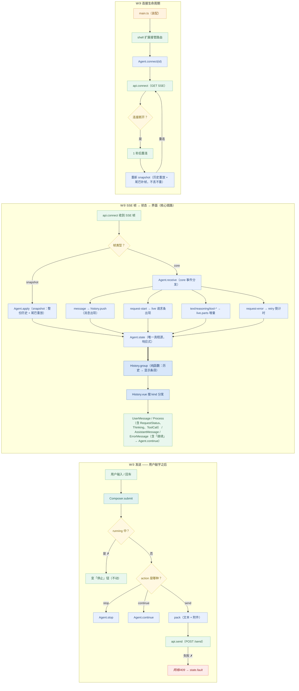

# 架构图

由 `bun tools/architecture.js` 从代码自动生成，勿手改；改了架构重新生成即可。

**图例（图一、图三、图四）**：实线 → import；粗线 ⇒ HTTP/SSE 数据流；虚线 ⇢ patch（扩展改写宿主方法）／inject（宿主反向注入）／扩展拓扑（requires/after）／登记。节点内是导出函数清单（超过 8 个显示 +n，本身就提示该文件该拆分）。图二的图例见其章节。

## 一、宏观：五个架构层

每层一个分组框，**层间连线只有向下**（agent-core ← backend ← web/扩展 → 外部依赖）；
扩展组只有虚线（patch / 拓扑 / 登记）指向宿主——实线越层或跨组向上即违规。
节点内嵌导出函数清单（超 8 个显示 +n，本身就是该拆文件的信号）。

```mermaid
graph TD
    subgraph g0["agent-core（npm，唯一循环）"]
    n1n01kdc["<b>@kernel4632/agent-core（npm）</b>"]:::agent-core
    end
    subgraph g1["backend —— Bun.serve 宿主"]
    nhqebqq["<b>server</b><br/>create()  wire()"]:::backend
    nbxek49["<b>Agents</b><br/>setup()  all()  open()  done()  running()  snapshot()  callbacks()  send() +6"]:::backend
    nfkptut["<b>Bundle</b><br/>forget()  pack()"]:::backend
    n1gcjvhk["<b>Extension</b><br/>patch()  scope()  invoke()  paths()  inspect()  revert()"]:::backend
    n1r47d4k["<b>Loader</b><br/>hook()  roots()  scan()  list()  entries()  inspect()  start()  stop() +3"]:::backend
    n6t2ykd["<b>Models</b><br/>list()  resolve()"]:::backend
    n4hgrwm["<b>Store</b><br/>config()  configure()  ensure()  meta()  touch()  history()  appendHistory()  rewriteHistory() +2"]:::store
    nytphuv["<b>Stream</b><br/>subscribe()  emit()  add()  tail()  retryDeadline()  clear()"]:::backend
    end
    subgraph g2["web —— Vue3 宿主"]
    naobem8["<b>api</b><br/>connect()"]:::web
    n14sdej9["<b>Agent</b><br/>stop()  configure()  connect()"]:::web
    n1qcy0uz["<b>Extension</b><br/>Components()  dispatch()  register()  load()  run()  Loaded()  Panels()  PlusMenu() +2"]:::web
    n2s7pfr["<b>main</b>"]:::web
    n3f77po["<b>App</b>"]:::webui
    end
    subgraph g3["extensions —— 内置九个（后端）"]
    nopqhf0["<b>mcp/backend</b>"]:::ext
    n10ycygf["<b>permission/backend</b>"]:::ext
    n6ceey8["<b>session/backend</b>"]:::ext
    n1bwj4wr["<b>settings/backend</b>"]:::ext
    n176bot2["<b>shell/backend</b>"]:::ext
    ndhwbyt["<b>skill/backend</b><br/>scan()"]:::ext
    n1pd8dgu["<b>title/backend</b>"]:::ext
    n19q3pg8["<b>todo/backend</b>"]:::ext
    n1xk5nt7["<b>tools/backend</b>"]:::ext
    end
    ne4psym["<b>vue（npm）</b>"]:::route
    noesvxz["<b>@hugeicons（npm）</b>"]:::route
    nqe4fzi["<b>markstream-vue（npm）</b>"]:::route
    n9necmj["<b>highlight.js（npm）</b>"]:::route
    nbxek49 --> n1n01kdc
    nbxek49 --> n4hgrwm
    nbxek49 --> n6t2ykd
    nbxek49 --> nytphuv
    n1r47d4k --> n1gcjvhk
    n1r47d4k --> nfkptut
    n1r47d4k --> n4hgrwm
    nhqebqq --> nbxek49
    nhqebqq --> nytphuv
    nhqebqq --> n4hgrwm
    nhqebqq --> n6t2ykd
    nhqebqq --> n1gcjvhk
    nhqebqq --> n1r47d4k
    n14sdej9 --> ne4psym
    n14sdej9 --> naobem8
    n3f77po --> ne4psym
    n3f77po --> n14sdej9
    n3f77po --> n1qcy0uz
    n1qcy0uz --> ne4psym
    n1qcy0uz --> naobem8
    n2s7pfr --> ne4psym
    n10ycygf -. patch Agents .-> nbxek49
    ndhwbyt -. patch Agents .-> nbxek49
    n1pd8dgu -. patch Agents .-> nbxek49
    n19q3pg8 -. patch Agents .-> nbxek49
    ndhwbyt -. 登记工具 .-> nbxek49
    n19q3pg8 -. 登记工具 .-> nbxek49
    n1xk5nt7 -. 登记工具 .-> nbxek49
    n1pd8dgu -.-> n6ceey8
    nhqebqq -. 注入 tools .-> n1gcjvhk
    nhqebqq -. 注入 targets .-> n1r47d4k
    nhqebqq ==> nbxek49
    nhqebqq ==> nytphuv
    nhqebqq ==> n1gcjvhk
    naobem8 == REST + SSE ==> nhqebqq
    nopqhf0 -. requires .-> n176bot2
    nopqhf0 -. after .-> n1bwj4wr
    n10ycygf -. requires .-> n176bot2
    n10ycygf -. after .-> n1bwj4wr
    n6ceey8 -. requires .-> n176bot2
    n1bwj4wr -. requires .-> n176bot2
    ndhwbyt -. requires .-> n176bot2
    ndhwbyt -. after .-> n1bwj4wr
    n1pd8dgu -. after .-> n6ceey8
    n19q3pg8 -. requires .-> n176bot2
    n19q3pg8 -. after .-> n1bwj4wr
    n1xk5nt7 -. after .-> n1bwj4wr
    n2s7pfr == 装配 4 个组件表项 ==> n1qcy0uz
    classDef agent-core fill:#eef1f5,stroke:#9aa7b8,color:#5a6572
    classDef backend fill:#e8f0fe,stroke:#7a9bd4,color:#2c4a7c
    classDef store fill:#d8e7fa,stroke:#5a86c4,color:#1d3c6e
    classDef web fill:#e9f7ee,stroke:#7cbf95,color:#2c5c3d
    classDef webui fill:#f2fbf5,stroke:#a5d4b8,color:#2c5c3d
    classDef ext fill:#f4edfb,stroke:#a98bc4,color:#5b3d80
    classDef route fill:#fff3e0,stroke:#e0a458,color:#8a5a1a
```



## 二、backend：九条 API 链路

每条 HTTP 路由一个组（九组并排，组间零连线）。**菱形节点 = 条件分支**（边上标「是/否」）；
**红字斜体 = 错误 / 拒绝路径**（409 / 400 / 404）；**粗线 ⇒ 交给 agent-core**（唯一循环）。
节点按文件着色（server 橙 / Agents 蓝 / Stream 青 / Models 紫 / Store 藏蓝 / Extension 紫 / Loader 淡紫 / Bundle 沙金 / core 灰 / 浏览器 绿）。
HTTP 信封（json / fail / read）所有路由等价使用，与运行路径无关，不画。
链路声明在 `tools/flow.js`，引用的函数与源码扫描比对——改名或删函数会直接报错，图不会悄悄过期。

```mermaid
graph LR
    subgraph c0["① POST /send —— 发消息"]
        c0_in["POST /api/agent/:id/send"]:::froute
        c0_send["Agents.send"]:::fagents
        c0_idle{"在运行中？"}:::fcheck
        c0_lock["409 正在运行"]:::fbad
        c0_fault{"配置缺失？"}:::fcheck
        c0_refuse["400 说明原因"]:::fbad
        c0_cut{"带 cut（改写重发）？"}:::fcheck
        c0_docut["Agents.cut"]:::fagents
        c0_rewrite["Store.rewriteHistory"]:::fstore
        c0_open["Agents.open"]:::fagents
        c0_read["Store.config / meta / history"]:::fstore
        c0_launch["launch"]:::fagents
        c0_run["Stream.emit(run start)"]:::fstream
        c0_core["agent-core 循环"]:::fcore
        c0_cb["Agents.callbacks"]:::fagents
        c0_save["Store.appendHistory（message）"]:::fstore
        c0_touch["Store.touch（step）"]:::fstore
        c0_add["Stream.add"]:::fstream
        c0_sse["浏览器（SSE）"]:::fweb
    end
    subgraph c1["② GET /stream —— 连接与刷新"]
        c1_in["GET /api/agent/:id/stream"]:::froute
        c1_open["Agents.open"]:::fagents
        c1_sub["Stream.subscribe"]:::fstream
        c1_snap["Agents.snapshot"]:::fagents
        c1_tail["Stream.tail（合并后的尾巴）"]:::fstream
        c1_retry["Stream.retryDeadline"]:::fstream
        c1_sse["浏览器（snapshot 首帧）"]:::fweb
        c1_core["agent-core 事件"]:::fcore
        c1_add["Stream.add"]:::fstream
        c1_emit["Stream.emit"]:::fstream
        c1_sse2["浏览器（core 事件）"]:::fweb
    end
    subgraph c2["③ POST /compact —— 手动压缩"]
        c2_in["POST /api/agent/:id/compact"]:::froute
        c2_compact["Agents.compact"]:::fagents
        c2_idle{"在运行中？"}:::fcheck
        c2_lock["409 正在运行"]:::fbad
        c2_launch["launch"]:::fagents
        c2_run["Stream.emit(run start)"]:::fstream
        c2_core["agent-core（compact 循环）"]:::fcore
        c2_cb["Agents.callbacks"]:::fagents
        c2_save["Store.appendHistory（总结消息）"]:::fstore
        c2_end["run end（历史变短）"]:::fweb
    end
    subgraph c3["④ POST /stop —— 停止"]
        c3_in["POST /api/agent/:id/stop"]:::froute
        c3_stop["Agents.stop"]:::fagents
        c3_core["agent-core（中止信号）"]:::fcore
        c3_wait["Agents.done（等任务收尾）"]:::fagents
        c3_run["run stopped"]:::fweb
    end
    subgraph c4["⑤ POST /configure —— 换模型 / 思考强度"]
        c4_in["POST /api/agent/:id/configure"]:::froute
        c4_configure["Agents.configure"]:::fagents
        c4_touch["Store.touch（写 meta）"]:::fstore
        c4_resolve["Models.resolve"]:::fmodels
        c4_hot["热替换 agent.config"]:::fagents
        c4_out["返回新 model / effort"]:::fserver
    end
    subgraph c5["⑥ GET /extensions —— 前端入口列表"]
        c5_in["GET /api/extensions"]:::froute
        c5_entries["Loader.entries"]:::floader
        c5_out["已加载扩展的 frontend.js 地址"]:::fweb
    end
    subgraph c6["⑦ GET /extensions/inspect —— 加载状态"]
        c6_in["GET /api/extensions/inspect"]:::froute
        c6_inspect["Loader.inspect"]:::floader
        c6_chain["Extension.inspect（patch 链 / 动作表）"]:::fextension
        c6_out["加载状态 + 冲突可见"]:::fweb
    end
    subgraph c7["⑧ GET /extensions/:name/frontend.js —— 扩展前端"]
        c7_in["GET /api/extensions/:name/frontend.js"]:::froute
        c7_frontend["frontend()"]:::fserver
        c7_bundle["Loader.bundle"]:::floader
        c7_pack["Bundle.pack（mtime 缓存，改 .vue 重打）"]:::fbundle
        c7_out["ESM 前端包（vue 外部化）"]:::fweb
    end
    c0_in --> c0_send
    c0_send --> c0_idle
    c0_idle -- 是 ✗ --> c0_lock
    c0_idle -- 否 --> c0_fault
    c0_fault -- 是 ✗ --> c0_refuse
    c0_fault -- 否 --> c0_cut
    c0_cut -- 是 --> c0_docut
    c0_cut -- 否 --> c0_open
    c0_docut --> c0_rewrite
    c0_rewrite --> c0_open
    c0_open --> c0_read
    c0_read --> c0_launch
    c0_launch --> c0_run
    c0_run --> c0_core
    c0_core ==> c0_cb
    c0_cb -- message --> c0_save
    c0_cb -- step --> c0_touch
    c0_cb -- 每事件 --> c0_add
    c0_add --> c0_sse
    c1_in --> c1_open
    c1_open --> c1_sub
    c1_sub --> c1_snap
    c1_snap -- 含尾巴 --> c1_tail
    c1_snap -- 含重试 --> c1_retry
    c1_tail --> c1_sse
    c1_retry --> c1_sse
    c1_core ==> c1_add
    c1_add --> c1_emit
    c1_emit --> c1_sse2
    c2_in --> c2_compact
    c2_compact --> c2_idle
    c2_idle -- 是 ✗ --> c2_lock
    c2_idle -- 否 --> c2_launch
    c2_launch --> c2_run
    c2_run --> c2_core
    c2_core ==> c2_cb
    c2_cb --> c2_save
    c2_save --> c2_end
    c3_in --> c3_stop
    c3_stop ==> c3_core
    c3_core ==> c3_wait
    c3_wait --> c3_run
    c4_in --> c4_configure
    c4_configure --> c4_touch
    c4_touch --> c4_resolve
    c4_resolve --> c4_hot
    c4_hot --> c4_out
    c5_in --> c5_entries
    c5_entries --> c5_out
    c6_in --> c6_inspect
    c6_inspect --> c6_chain
    c6_chain --> c6_out
    c7_in --> c7_frontend
    c7_frontend --> c7_bundle
    c7_bundle --> c7_pack
    c7_pack --> c7_out
    classDef fserver fill:#fff3e0,stroke:#e0a458,color:#8a5a1a
    classDef fagents fill:#e8f0fe,stroke:#7a9bd4,color:#2c4a7c
    classDef fstream fill:#e0f2f1,stroke:#6db3a8,color:#1d5c50
    classDef fmodels fill:#f3e8fe,stroke:#b48ee0,color:#4a2c7c
    classDef fstore fill:#d8e7fa,stroke:#5a86c4,color:#1d3c6e
    classDef fextension fill:#f4edfb,stroke:#a98bc4,color:#5b3d80
    classDef floader fill:#ede7f6,stroke:#9575cd,color:#3e2c63
    classDef fbundle fill:#fdf0e7,stroke:#d4a76a,color:#6b4a1f
    classDef fcore fill:#eef1f5,stroke:#9aa7b8,color:#5a6572
    classDef fweb fill:#e9f7ee,stroke:#7cbf95,color:#2c5c3d
    classDef froute fill:#e3f2fd,stroke:#64b5f6,color:#0d47a1,font-weight:bold
    classDef fcheck fill:#fff8e1,stroke:#e0c240,color:#7a6410
    classDef fbad fill:#fdecea,stroke:#e57373,color:#8f1f1f,font-style:italic
```



## 三、web：三条事件链路

前端的运行单位是**事件流**：事件进来 → `Agent.state`（唯一真相源）变 → 界面响应式重渲染。
组件之间的 import 关系不是架构，故不画；响应式传播是 Vue 的事，图中只画一次「state → 界面」。
- **W① 发送**：敲字/回车后的分支（停止 / 继续 / 发送），不乐观渲染——用户消息等 core 收下才出现
- **W② SSE → 界面（核心）**：snapshot 整份重放、core 事件分四类入 state、`History.group` 纯函数派生、按 kind 分发组件
- **W③ 连接生命周期**：断线 1 秒重连，重新 snapshot 保证不丢帧不重帧



## 四、extensions：宿主接口 ⇄ 内置扩展

左组是扩展的全部接入点：后端 `ctx = Extension.scope`（patch 链 / 登记表），前端 `app`（`web/src/Extension.ts`）。
右组九个扩展；**虚线 requires/after = manifest 拓扑**（后加载的可以依赖先加载的）、**patch = 扩展改写宿主方法**、
**登记工具/动作 = ctx.tool / ctx.op**。哪个扩展包住了哪个方法，看它发出的虚线指向谁。

```mermaid
graph TD
    subgraph g0["宿主接口 —— 扩展从这里接入（ctx = Extension.scope）"]
    n1gcjvhk["<b>Extension</b><br/>patch()  scope()  invoke()  paths()  inspect()  revert()"]:::backend
    nbxek49["<b>Agents</b><br/>setup()  all()  open()  done()  running()  snapshot()  callbacks()  send() +6"]:::backend
    n4hgrwm["<b>Store</b><br/>config()  configure()  ensure()  meta()  touch()  history()  appendHistory()  rewriteHistory() +2"]:::store
    n1qcy0uz["<b>Extension</b><br/>Components()  dispatch()  register()  load()  run()  Loaded()  Panels()  PlusMenu() +2"]:::web
    end
    subgraph g1["内置扩展（后端 backend.js；前端入口由 Loader 打包）"]
    nopqhf0["<b>mcp/backend</b>"]:::ext
    n10ycygf["<b>permission/backend</b>"]:::ext
    n6ceey8["<b>session/backend</b>"]:::ext
    n1bwj4wr["<b>settings/backend</b>"]:::ext
    n176bot2["<b>shell/backend</b>"]:::ext
    ndhwbyt["<b>skill/backend</b><br/>scan()"]:::ext
    n1pd8dgu["<b>title/backend</b>"]:::ext
    n19q3pg8["<b>todo/backend</b>"]:::ext
    n1xk5nt7["<b>tools/backend</b>"]:::ext
    end
    nbxek49 --> n4hgrwm
    n10ycygf -. patch Agents .-> nbxek49
    ndhwbyt -. patch Agents .-> nbxek49
    n1pd8dgu -. patch Agents .-> nbxek49
    n19q3pg8 -. patch Agents .-> nbxek49
    ndhwbyt -. 登记工具 .-> nbxek49
    n19q3pg8 -. 登记工具 .-> nbxek49
    n1xk5nt7 -. 登记工具 .-> nbxek49
    n1pd8dgu -.-> n6ceey8
    nopqhf0 -. requires .-> n176bot2
    nopqhf0 -. after .-> n1bwj4wr
    n10ycygf -. requires .-> n176bot2
    n10ycygf -. after .-> n1bwj4wr
    n6ceey8 -. requires .-> n176bot2
    n1bwj4wr -. requires .-> n176bot2
    ndhwbyt -. requires .-> n176bot2
    ndhwbyt -. after .-> n1bwj4wr
    n1pd8dgu -. after .-> n6ceey8
    n19q3pg8 -. requires .-> n176bot2
    n19q3pg8 -. after .-> n1bwj4wr
    n1xk5nt7 -. after .-> n1bwj4wr
    classDef agent-core fill:#eef1f5,stroke:#9aa7b8,color:#5a6572
    classDef backend fill:#e8f0fe,stroke:#7a9bd4,color:#2c4a7c
    classDef store fill:#d8e7fa,stroke:#5a86c4,color:#1d3c6e
    classDef web fill:#e9f7ee,stroke:#7cbf95,color:#2c5c3d
    classDef webui fill:#f2fbf5,stroke:#a5d4b8,color:#2c5c3d
    classDef ext fill:#f4edfb,stroke:#a98bc4,color:#5b3d80
    classDef route fill:#fff3e0,stroke:#e0a458,color:#8a5a1a
```



## 五、机器检查

```
  ✓ 全部通过：无循环依赖、扩展未绕 ctx、组件未绕 Agent、fetch 出口唯一、入口未被下游引用
```
