# 架构图

由 `bun tools/architecture.js` 从代码自动生成，勿手改；改了架构重新生成即可。

**图例（图一、图三、图四）**：实线 → import；粗线 ⇒ HTTP/SSE 数据流；虚线 ⇢ patch（扩展改写宿主方法）／inject（宿主反向注入）／扩展拓扑（requires/after）／登记。节点内是导出函数清单（超过 8 个显示 +n，本身就提示该文件该拆分）。图二的图例见其章节。

## 一、宏观：core → 后端 → 前端 → 扩展

```mermaid
graph TD
    n1n01kdc["<b>@kernel4632/agent-core（npm）</b>"]:::agent-core
    ne4psym["<b>vue（npm）</b>"]:::route
    noesvxz["<b>@hugeicons（npm）</b>"]:::route
    nhqebqq["<b>server</b><br/>create()  wire()"]:::backend
    nbxek49["<b>Agents</b><br/>setup()  all()  open()  done()  running()  snapshot()  callbacks()  send() +6"]:::backend
    nfkptut["<b>Bundle</b><br/>forget()  pack()"]:::backend
    n1gcjvhk["<b>Extension</b><br/>patch()  scope()  invoke()  paths()  inspect()  revert()"]:::backend
    n1r47d4k["<b>Loader</b><br/>hook()  roots()  scan()  list()  entries()  inspect()  start()  stop() +3"]:::backend
    n6t2ykd["<b>Models</b><br/>list()  resolve()"]:::backend
    n4hgrwm["<b>Store</b><br/>config()  configure()  ensure()  meta()  touch()  history()  appendHistory()  rewriteHistory() +2"]:::store
    nytphuv["<b>Stream</b><br/>subscribe()  emit()  add()  tail()  retryDeadline()  clear()"]:::backend
    naobem8["<b>api</b><br/>connect()"]:::web
    n14sdej9["<b>Agent</b><br/>stop()  configure()  connect()"]:::web
    n1qcy0uz["<b>Extension</b><br/>Components()  dispatch()  register()  load()  run()  Loaded()  Panels()  PlusMenu() +2"]:::web
    n2s7pfr["<b>main</b>"]:::web
    n3f77po["<b>App</b>"]:::webui
    nopqhf0["<b>mcp/backend</b>"]:::ext
    n10ycygf["<b>permission/backend</b>"]:::ext
    n6ceey8["<b>session/backend</b>"]:::ext
    n1bwj4wr["<b>settings/backend</b>"]:::ext
    n176bot2["<b>shell/backend</b>"]:::ext
    ndhwbyt["<b>skill/backend</b><br/>scan()"]:::ext
    n1pd8dgu["<b>title/backend</b>"]:::ext
    n19q3pg8["<b>todo/backend</b>"]:::ext
    n1xk5nt7["<b>tools/backend</b>"]:::ext
    nbxek49 --> n1n01kdc
    nbxek49 --> n4hgrwm
    nbxek49 --> n6t2ykd
    nbxek49 --> nytphuv
    n1r47d4k --> n1gcjvhk
    n1r47d4k --> nfkptut
    n1r47d4k --> n4hgrwm
    nhqebqq --> nbxek49
    nhqebqq --> nytphuv
    nhqebqq --> n4hgrwm
    nhqebqq --> n6t2ykd
    nhqebqq --> n1gcjvhk
    nhqebqq --> n1r47d4k
    n14sdej9 --> ne4psym
    n14sdej9 --> naobem8
    n3f77po --> ne4psym
    n3f77po --> n14sdej9
    n3f77po --> n1qcy0uz
    n1qcy0uz --> ne4psym
    n1qcy0uz --> naobem8
    n2s7pfr --> ne4psym
    n2s7pfr --> n3f77po
    n2s7pfr --> n14sdej9
    n2s7pfr --> naobem8
    n2s7pfr --> n1qcy0uz
    n10ycygf -. patch Agents .-> nbxek49
    ndhwbyt -. patch Agents .-> nbxek49
    n1pd8dgu -. patch Agents .-> nbxek49
    n19q3pg8 -. patch Agents .-> nbxek49
    ndhwbyt -. 登记工具 .-> nbxek49
    n19q3pg8 -. 登记工具 .-> nbxek49
    n1xk5nt7 -. 登记工具 .-> nbxek49
    n1pd8dgu -.-> n6ceey8
    nhqebqq -. 注入 tools .-> n1gcjvhk
    nhqebqq -. 注入 targets .-> n1r47d4k
    nhqebqq ==> nbxek49
    nhqebqq ==> nytphuv
    nhqebqq ==> n1gcjvhk
    naobem8 == REST + SSE ==> nhqebqq
    nopqhf0 -. requires .-> n176bot2
    nopqhf0 -. after .-> n1bwj4wr
    n10ycygf -. requires .-> n176bot2
    n10ycygf -. after .-> n1bwj4wr
    n6ceey8 -. requires .-> n176bot2
    n1bwj4wr -. requires .-> n176bot2
    ndhwbyt -. requires .-> n176bot2
    ndhwbyt -. after .-> n1bwj4wr
    n1pd8dgu -. after .-> n6ceey8
    n19q3pg8 -. requires .-> n176bot2
    n19q3pg8 -. after .-> n1bwj4wr
    n1xk5nt7 -. after .-> n1bwj4wr
    classDef agent-core fill:#eef1f5,stroke:#9aa7b8,color:#5a6572
    classDef backend fill:#e8f0fe,stroke:#7a9bd4,color:#2c4a7c
    classDef store fill:#d8e7fa,stroke:#5a86c4,color:#1d3c6e
    classDef web fill:#e9f7ee,stroke:#7cbf95,color:#2c5c3d
    classDef webui fill:#f2fbf5,stroke:#a5d4b8,color:#2c5c3d
    classDef ext fill:#f4edfb,stroke:#a98bc4,color:#5b3d80
    classDef route fill:#fff3e0,stroke:#e0a458,color:#8a5a1a
```



## 二、backend：函数级流程图

文件是分组框（subgraph），函数是节点。**实线 → 运行时调用**（路由 → 业务函数 → Store/Stream/Models…）；
**粗线 ⇒ 交给 agent-core**（唯一循环，内部不可见）；
斜体淡色 = 文件内非导出的辅助函数（不是公开接口，但在执行路径上，名字撞车的加 ′ 区分）。
backend 同层文件之间没有静态 import（导入只往下走的铁律），跨文件调用全部发生在运行时——这张图按 `Name.method(` 调用点扫描还原。

```mermaid
graph TD
    subgraph s0["backend/server.js"]
        0_wire["wire()"]:::fbackend
        0_create["create()"]:::fbackend
        0_json["json()"]:::fhelper
        0_fail["fail()"]:::fhelper
        0_read["read()"]:::fhelper
        0_frame["frame()"]:::fhelper
        0_stream["stream()"]:::fhelper
        0_frontend["frontend()"]:::fhelper
        0_r0["GET /api/agent/:id/stream"]:::froute
        0_r1["POST /api/agent/:id/send"]:::froute
        0_r2["POST /api/agent/:id/compact"]:::froute
        0_r3["POST /api/agent/:id/stop"]:::froute
        0_r4["POST /api/agent/:id/configure"]:::froute
        0_r5["GET /api/extensions"]:::froute
        0_r6["GET /api/extensions/inspect"]:::froute
        0_r7["GET /api/extensions/:name/frontend.js"]:::froute
        0_r8["POST /api/op/:name"]:::froute
    end
    subgraph s1["backend/features/Agents.js"]
        1_setup["setup()"]:::fbackend
        1_all["all()"]:::fbackend
        1_open["open()"]:::fbackend
        1_done["done()"]:::fbackend
        1_running["running()"]:::fbackend
        1_snapshot["snapshot()"]:::fbackend
        1_callbacks["callbacks()"]:::fbackend
        1_send["send()"]:::fbackend
        1_compact["compact()"]:::fbackend
        1_stop["stop()"]:::fbackend
        1_configure["configure()"]:::fbackend
        1_cut["cut()"]:::fbackend
        1_drop["drop()"]:::fbackend
        1_remove["remove()"]:::fbackend
        1_busy["busy()"]:::fhelper
        1_idle["idle()"]:::fhelper
        1_options["options()"]:::fhelper
        1_launch["launch()"]:::fhelper
    end
    subgraph s2["backend/features/Stream.js"]
        2_subscribe["subscribe()"]:::fbackend
        2_emit["emit()"]:::fbackend
        2_add["add()"]:::fbackend
        2_tail["tail()"]:::fbackend
        2_retryDeadline["retryDeadline()"]:::fbackend
        2_clear["clear()"]:::fbackend
        2_slot["slot()"]:::fhelper
        2_merge["merge()"]:::fhelper
    end
    subgraph s3["backend/features/Models.js"]
        3_list["list()"]:::fbackend
        3_resolve["resolve()"]:::fbackend
    end
    subgraph s4["backend/features/Store.js"]
        4_config["config()"]:::store
        4_configure["configure()"]:::store
        4_ensure["ensure()"]:::store
        4_meta["meta()"]:::store
        4_touch["touch()"]:::store
        4_history["history()"]:::store
        4_appendHistory["appendHistory()"]:::store
        4_rewriteHistory["rewriteHistory()"]:::store
        4_list["list()"]:::store
        4_remove["remove()"]:::store
        4_home["home()"]:::fhelper
        4_dir["dir()"]:::fhelper
        4_enqueue["enqueue()"]:::fhelper
        4_read["read()"]:::fhelper
        4_write["write()"]:::fhelper
    end
    subgraph s5["backend/features/Extension.js"]
        5_patch["patch()"]:::fbackend
        5_scope["scope()"]:::fbackend
        5_invoke["invoke()"]:::fbackend
        5_paths["paths()"]:::fbackend
        5_inspect["inspect()"]:::fbackend
        5_revert["revert()"]:::fbackend
        5_mark["mark()"]:::fhelper
        5_restack["restack()"]:::fhelper
        5_track["track()"]:::fhelper
    end
    subgraph s6["backend/features/Loader.js"]
        6_hook["hook()"]:::fbackend
        6_roots["roots()"]:::fbackend
        6_scan["scan()"]:::fbackend
        6_list["list()"]:::fbackend
        6_entries["entries()"]:::fbackend
        6_inspect["inspect()"]:::fbackend
        6_start["start()"]:::fbackend
        6_stop["stop()"]:::fbackend
        6_bundle["bundle()"]:::fbackend
        6_toggle["toggle()"]:::fbackend
        6_reset["reset()"]:::fbackend
        6_exists["exists()"]:::fhelper
        6_scanh["scan′()"]:::fhelper
        6_compatible["compatible()"]:::fhelper
        6_sort["sort()"]:::fhelper
        6_hooks["hooks()"]:::fhelper
        6_weave["weave()"]:::fhelper
    end
    subgraph s7["backend/features/Bundle.js"]
        7_forget["forget()"]:::fbackend
        7_pack["pack()"]:::fbackend
        7_mtime["mtime()"]:::fhelper
        7_fallbackPlugin["fallbackPlugin()"]:::fhelper
        7_vuePlugin["vuePlugin()"]:::fhelper
        7_rewrite["rewrite()"]:::fhelper
    end
    core["<b>agent-core</b>（唯一循环，内部不可见）"]:::fcore
    0_wire --> 1_setup
    0_wire --> 5_paths
    0_wire --> 6_hook
    0_wire --> 2_emit
    0_wire --> 1_all
    0_create --> 0_wire
    0_fail --> 0_json
    0_stream --> 1_open
    0_stream --> 2_subscribe
    0_stream --> 1_snapshot
    0_stream --> 0_frame
    0_frontend --> 6_bundle
    0_frontend --> 0_json
    0_r0 --> 0_stream
    0_r1 --> 1_send
    0_r1 --> 0_read
    0_r1 --> 0_json
    0_r1 --> 0_fail
    0_r2 --> 1_compact
    0_r2 --> 0_json
    0_r2 --> 0_fail
    0_r3 --> 1_stop
    0_r3 --> 0_json
    0_r3 --> 0_fail
    0_r4 --> 1_configure
    0_r4 --> 0_json
    0_r4 --> 0_read
    0_r4 --> 0_fail
    0_r5 --> 6_entries
    0_r5 --> 0_json
    0_r6 --> 6_inspect
    0_r6 --> 0_json
    0_r7 --> 0_frontend
    0_r8 --> 5_invoke
    0_r8 --> 0_json
    0_r8 --> 0_read
    0_r8 --> 0_fail
    1_open --> 4_ensure
    1_open --> 4_config
    1_open --> 4_meta
    1_open --> 4_history
    1_open == create ==> core
    1_open --> 1_options
    1_snapshot --> 2_tail
    1_snapshot --> 1_running
    1_snapshot --> 2_retryDeadline
    1_callbacks --> 4_appendHistory
    1_callbacks --> 4_touch
    1_callbacks --> 2_add
    1_send --> 1_open
    1_send --> 1_cut
    1_send --> 1_callbacks
    1_send == send ==> core
    1_send --> 1_idle
    1_send --> 1_launch
    1_compact --> 1_callbacks
    1_compact == compact ==> core
    1_compact --> 1_idle
    1_compact --> 1_launch
    1_stop --> 1_open
    1_stop --> 1_done
    1_stop == stop ==> core
    1_configure --> 1_open
    1_configure --> 4_config
    1_configure --> 4_touch
    1_configure --> 3_list
    1_configure --> 3_resolve
    1_cut --> 1_open
    1_cut --> 2_clear
    1_cut --> 4_rewriteHistory
    1_cut --> 2_emit
    1_cut --> 1_idle
    1_drop --> 2_clear
    1_remove --> 1_drop
    1_remove --> 4_remove
    1_remove == stop ==> core
    1_remove --> 1_busy
    1_idle --> 1_busy
    1_options --> 3_list
    1_options --> 3_resolve
    1_launch --> 1_open
    1_launch --> 2_emit
    2_add --> 2_emit
    2_add --> 2_slot
    2_add --> 2_merge
    2_tail --> 2_slot
    2_retryDeadline --> 2_slot
    4_config --> 4_home
    4_config --> 4_read
    4_config --> 4_write
    4_configure --> 4_write
    4_configure --> 4_home
    4_ensure --> 4_dir
    4_meta --> 4_read
    4_meta --> 4_dir
    4_touch --> 4_ensure
    4_touch --> 4_meta
    4_touch --> 4_enqueue
    4_touch --> 4_write
    4_touch --> 4_dir
    4_history --> 4_dir
    4_appendHistory --> 4_ensure
    4_appendHistory --> 4_enqueue
    4_appendHistory --> 4_dir
    4_rewriteHistory --> 4_ensure
    4_rewriteHistory --> 4_enqueue
    4_rewriteHistory --> 4_dir
    4_list --> 4_home
    4_remove --> 4_enqueue
    4_remove --> 4_dir
    4_dir --> 4_home
    5_patch --> 5_restack
    5_patch --> 5_track
    5_scope --> 5_patch
    5_scope --> 5_track
    5_restack --> 5_mark
    6_scan --> 6_scanh
    6_entries --> 6_list
    6_inspect --> 5_inspect
    6_inspect --> 6_list
    6_start --> 6_stop
    6_start --> 4_config
    6_start --> 6_scan
    6_start --> 6_roots
    6_start --> 5_revert
    6_start --> 6_list
    6_start --> 6_compatible
    6_start --> 6_sort
    6_start --> 6_weave
    6_stop --> 5_revert
    6_stop --> 7_forget
    6_bundle --> 7_pack
    6_toggle --> 4_config
    6_toggle --> 4_configure
    6_toggle --> 6_start
    6_reset --> 5_revert
    6_reset --> 7_forget
    6_scanh --> 6_exists
    6_weave --> 5_scope
    6_weave --> 6_exists
    6_weave --> 6_hooks
    7_pack --> 7_mtime
    7_pack --> 7_vuePlugin
    7_pack --> 7_fallbackPlugin
    7_pack --> 7_rewrite
    classDef fbackend fill:#e8f0fe,stroke:#7a9bd4,color:#2c4a7c
    classDef store fill:#d8e7fa,stroke:#5a86c4,color:#1d3c6e
    classDef fhelper fill:#f4f6f9,stroke:#c3ccd8,color:#8593a6,font-style:italic
    classDef froute fill:#fff3e0,stroke:#e0a458,color:#8a5a1a
    classDef fcore fill:#eef1f5,stroke:#9aa7b8,color:#5a6572
```



## 三、web

```mermaid
graph TD
    n14sdej9["<b>Agent</b><br/>stop()  configure()  connect()"]:::web
    naobem8["<b>api</b><br/>connect()"]:::web
    n3f77po["<b>App</b>"]:::webui
    nmdvte5["<b>AssistantMessage</b>"]:::webui
    n1x4hqj0["<b>CodeBlock</b>"]:::webui
    n1eedbfs["<b>CompactMessage</b>"]:::webui
    n1fukcf8["<b>Composer</b>"]:::webui
    n1p9n7s3["<b>ErrorMessage</b>"]:::webui
    n18bqnpc["<b>History</b><br/>History()"]:::webui
    n1v8qy0t["<b>Icon</b>"]:::webui
    n15uqdp7["<b>Process</b>"]:::webui
    n1txskb1["<b>RequestStatus</b>"]:::webui
    ne2t5vv["<b>Stats</b>"]:::webui
    n13y2e7o["<b>Thinking</b>"]:::webui
    nlm1wpm["<b>ToolCall</b>"]:::webui
    nfh54tk["<b>UserMessage</b>"]:::webui
    nep9kbh["<b>demo</b>"]:::web
    net13y9["<b>dev-extensions.prod</b><br/>loadDevExtensions()"]:::web
    nx39sr8["<b>dev-extensions</b><br/>loadDevExtensions()"]:::web
    n1qcy0uz["<b>Extension</b><br/>Components()  dispatch()  register()  load()  run()  Loaded()  Panels()  PlusMenu() +2"]:::web
    n7xbudi["<b>history</b><br/>group()"]:::web
    n2s7pfr["<b>main</b>"]:::web
    n492da9["<b>types</b>"]:::web
    n14sdej9 --> naobem8
    n3f77po --> n14sdej9
    n3f77po --> n1qcy0uz
    nmdvte5 --> n1qcy0uz
    n1x4hqj0 --> n1v8qy0t
    n1eedbfs --> n1v8qy0t
    n1fukcf8 --> n14sdej9
    n1fukcf8 --> n1v8qy0t
    n1fukcf8 --> n1qcy0uz
    n1p9n7s3 --> n1v8qy0t
    n1p9n7s3 --> n14sdej9
    n18bqnpc --> n7xbudi
    n18bqnpc --> n14sdej9
    n18bqnpc --> n1qcy0uz
    n15uqdp7 --> n1v8qy0t
    n15uqdp7 --> n1qcy0uz
    n1txskb1 --> n1v8qy0t
    ne2t5vv --> n1v8qy0t
    ne2t5vv --> n14sdej9
    n13y2e7o --> n1v8qy0t
    nlm1wpm --> n1v8qy0t
    nlm1wpm --> n1qcy0uz
    nfh54tk --> n1v8qy0t
    nfh54tk --> n14sdej9
    nep9kbh --> naobem8
    nep9kbh --> n1qcy0uz
    nx39sr8 --> n1qcy0uz
    n1qcy0uz --> naobem8
    n2s7pfr --> n3f77po
    n2s7pfr --> n14sdej9
    n2s7pfr --> naobem8
    n2s7pfr --> n1qcy0uz
    n2s7pfr --> nx39sr8
    n2s7pfr --> net13y9
    n2s7pfr --> n18bqnpc
    n2s7pfr --> nfh54tk
    n2s7pfr --> nmdvte5
    n2s7pfr --> n1x4hqj0
    n2s7pfr --> n13y2e7o
    n2s7pfr --> nlm1wpm
    n2s7pfr --> n15uqdp7
    n2s7pfr --> n1txskb1
    n2s7pfr --> n1p9n7s3
    n2s7pfr --> n1eedbfs
    n2s7pfr --> n1fukcf8
    n2s7pfr --> ne2t5vv
    n2s7pfr --> n1v8qy0t
    n2s7pfr --> nep9kbh
    nep9kbh -.-> naobem8
    classDef agent-core fill:#eef1f5,stroke:#9aa7b8,color:#5a6572
    classDef backend fill:#e8f0fe,stroke:#7a9bd4,color:#2c4a7c
    classDef store fill:#d8e7fa,stroke:#5a86c4,color:#1d3c6e
    classDef web fill:#e9f7ee,stroke:#7cbf95,color:#2c5c3d
    classDef webui fill:#f2fbf5,stroke:#a5d4b8,color:#2c5c3d
    classDef ext fill:#f4edfb,stroke:#a98bc4,color:#5b3d80
    classDef route fill:#fff3e0,stroke:#e0a458,color:#8a5a1a
```



## 四、extensions（拓扑：requires / after / patch / use）

```mermaid
graph TD
    nopqhf0["<b>mcp/backend</b>"]:::ext
    n10ycygf["<b>permission/backend</b>"]:::ext
    n6ceey8["<b>session/backend</b>"]:::ext
    n1bwj4wr["<b>settings/backend</b>"]:::ext
    n176bot2["<b>shell/backend</b>"]:::ext
    ndhwbyt["<b>skill/backend</b><br/>scan()"]:::ext
    n1pd8dgu["<b>title/backend</b>"]:::ext
    n19q3pg8["<b>todo/backend</b>"]:::ext
    n1xk5nt7["<b>tools/backend</b>"]:::ext
    n1p4lu5a["<b>mcp/manifest.json</b>"]:::ext
    nh9mo8r["<b>permission/manifest.json</b>"]:::ext
    n9ybtui["<b>session/manifest.json</b>"]:::ext
    nvbxbwv["<b>settings/manifest.json</b>"]:::ext
    nypfrp0["<b>shell/manifest.json</b>"]:::ext
    n3qc1n9["<b>skill/manifest.json</b>"]:::ext
    nndscv0["<b>title/manifest.json</b>"]:::ext
    n1fqln5e["<b>todo/manifest.json</b>"]:::ext
    njiy8v3["<b>tools/manifest.json</b>"]:::ext
    n13im5ax["<b>mcp</b>"]:::ext
    n1qtj8za["<b>permission</b>"]:::ext
    n178volx["<b>session</b>"]:::ext
    n17ncvwq["<b>settings</b>"]:::ext
    n1c2qxkf["<b>shell</b>"]:::ext
    nvyz2a8["<b>skill</b>"]:::ext
    nktdwj1["<b>todo</b>"]:::ext
    n1i1cj8a["<b>tools</b>"]:::ext
    n1qcy0uz["<b>Extension</b><br/>Components()  dispatch()  register()  load()  run()  Loaded()  Panels()  PlusMenu() +2"]:::web
    n1pd8dgu -.-> n6ceey8
    n1c2qxkf -.-> n1qcy0uz
    n1i1cj8a -.-> n1qcy0uz
    nopqhf0 -. requires .-> n176bot2
    nopqhf0 -. after .-> n1bwj4wr
    n10ycygf -. requires .-> n176bot2
    n10ycygf -. after .-> n1bwj4wr
    n6ceey8 -. requires .-> n176bot2
    n1bwj4wr -. requires .-> n176bot2
    ndhwbyt -. requires .-> n176bot2
    ndhwbyt -. after .-> n1bwj4wr
    n1pd8dgu -. after .-> n6ceey8
    n19q3pg8 -. requires .-> n176bot2
    n19q3pg8 -. after .-> n1bwj4wr
    n1xk5nt7 -. after .-> n1bwj4wr
    classDef agent-core fill:#eef1f5,stroke:#9aa7b8,color:#5a6572
    classDef backend fill:#e8f0fe,stroke:#7a9bd4,color:#2c4a7c
    classDef store fill:#d8e7fa,stroke:#5a86c4,color:#1d3c6e
    classDef web fill:#e9f7ee,stroke:#7cbf95,color:#2c5c3d
    classDef webui fill:#f2fbf5,stroke:#a5d4b8,color:#2c5c3d
    classDef ext fill:#f4edfb,stroke:#a98bc4,color:#5b3d80
    classDef route fill:#fff3e0,stroke:#e0a458,color:#8a5a1a
```



## 五、机器检查

```
  ✓ 全部通过：无循环依赖、扩展未绕 ctx、组件未绕 Agent、fetch 出口唯一、入口未被下游引用
```
